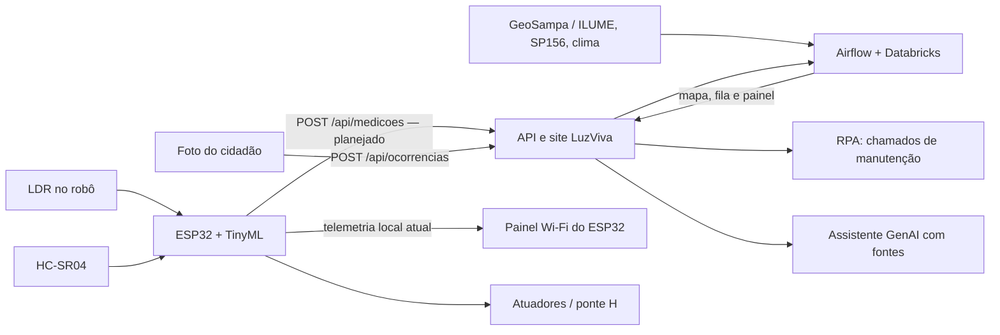

# Arquitetura LuzViva e integrações

## Objetivo

Monitorar pontos de iluminação pública à noite e fornecer evidências para priorizar manutenção nas áreas-piloto Sé, Pinheiros e Campo Limpo.

## Fluxo planejado do MVP

## Estado confirmado pelo firmware nesta pasta

- **LDR + TinyML:** o ESP32 amostra o ADC e chama `run_classifier`; o painel local mostra classe, confiança, ADC e mV.
- **Painel local:** o sketch cria um ponto de acesso Wi-Fi e serve a interface em `http://192.168.4.1`.
- **Controle manual:** comandos direcionais e parada são expostos por `/command`.
- **Modo automático:** o HC-SR04 determina avanço e manobras de evasão. A classificação do LDR é exibida, mas não comanda os motores.
- **Segurança frontal:** em manual, o avanço para diante é bloqueado se houver obstáculo detectado a 30 cm ou menos; no automático o robô para se o sensor não obtiver eco.
- **Integração com o app público:** ainda não implementada no sketch. Não há `POST /api/medicoes` neste firmware.

## Contrato de medição desejado

O roteiro da equipe prevê enviar cada medição ao app com um contrato contendo, entre outros campos, `id_medicao`, `robo_id`, `data_hora`, `lux`, `situacao_robo`, `sensor` e `area_piloto`; coordenadas e placa podem identificar o ponto quando disponíveis. A rota acordada é `POST /api/medicoes`.

O firmware atual ainda não produz todos esses campos: não converte ADC para lux, não tem GPS/placa configurados e não envia telemetria pela rede. A equipe deve completar esses itens em conjunto com quem mantém o app, preservando o contrato antes de alterar nomes ou tipos.

## Integração com as demais disciplinas

- **MakerLab:** sensor físico, processamento TinyML e resposta do dispositivo.
- **Big Data:** incorpora medições, ocorrências e fontes públicas à fila de manutenção.
- **Visão:** envia ocorrências detectadas em fotos para o app.
- **RPA:** consome a fila e registra/atualiza chamados no próprio MVP.
- **GenAI:** explica a prioridade da fila com fontes e pode recusar perguntas sem evidência.
- **DevOps:** publica e monitora o app e suas APIs.
- **BI & Startup:** demonstra o MVP e acompanha indicadores de negócio e impacto.

Os contratos completos definidos pela equipe estão no roteiro do projeto; ao copiar ou publicar contratos neste repositório, mantenha exemplos sem dados pessoais reais e sem segredos.
